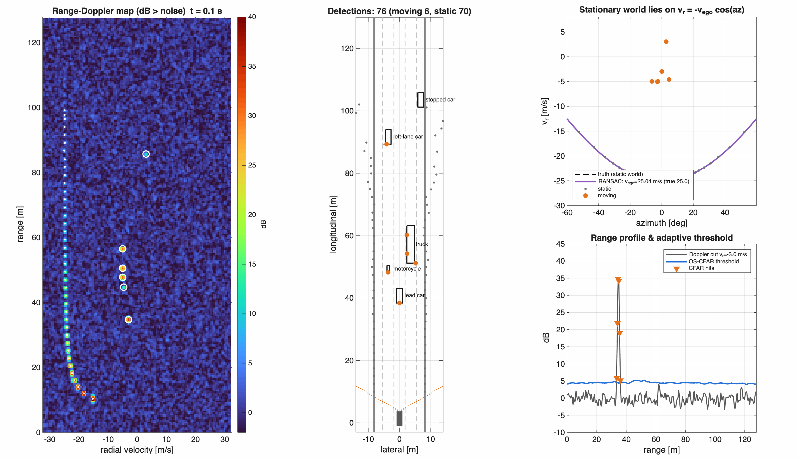

# Autonomous-Vehicle Sensor Fusion: from raw signals to fused tracks

An end-to-end, simulation-driven study of AV perception and sensor fusion in MATLAB, from a **signal-processing** and **perception engineering** point of view.
The core algorithms (radar DSP, CFAR, Kalman-family filters, data association, IMM, track-to-track fusion) are **implemented from scratch** in the `+sf` package. MathWorks toolboxes provide the scenarios and ground truth, and serve as **reference implementations to cross-validate** against.



## Roadmap

| # | Module | Status |
|---|---|---|
| 01 | [Sensor physics & noise modelling](modules/01_sensor_models) — Allan variance, GNSS error, radar/camera/lidar geometry | ✅ |
| 02 | [FMCW radar signal processing](modules/02_fmcw_radar) — raw IF → range-Doppler → exact CFAR → angle → calibrated detections, ego-motion | ✅ |
| 03 | Bayesian estimation from scratch — KF / EKF / UKF, NEES/NIS consistency | ⏳ |
| 04 | Ego localization — GNSS/IMU error-state EKF, tunnel outage | ⏳ |
| 05 | Multi-object tracking — gating, GNN, JPDA, M/N logic, IMM | ⏳ |
| 06 | Multi-sensor fusion — radar + camera + lidar, centralized vs. track-to-track, OOSM | ⏳ |
| 07 | Extended-object tracking with lidar | ⏳ |
| 08 | Capstone — full pipeline, failure injection, metrics, C code generation | ⏳ |

## Repository layout

```
+sf/            library: +imu +gnss +radar +camera +lidar +filters +metrics +viz
modules/NN_*/   one study per module: main.m + README with theory and results
tests/          matlab.unittest suites (every module's numerical claims are tested)
media/          figures and animations generated by the modules
```

## Quick start

```matlab
cd Sensor_fusion_project
startup
run('modules/01_sensor_models/main.m')
results = runtests('tests');
```

Requires MATLAB R2026b with the Sensor Fusion and Tracking, Automated Driving, Signal Processing, and Statistics toolboxes. All results are seeded and reproducible.
