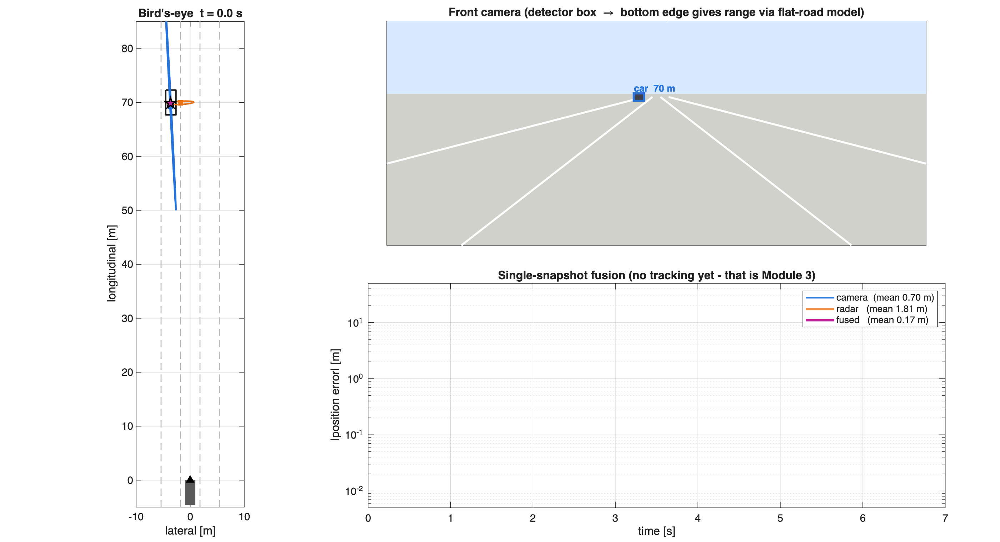
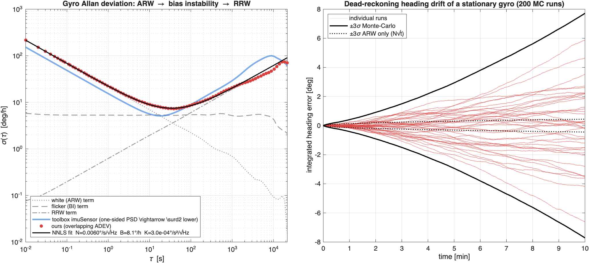
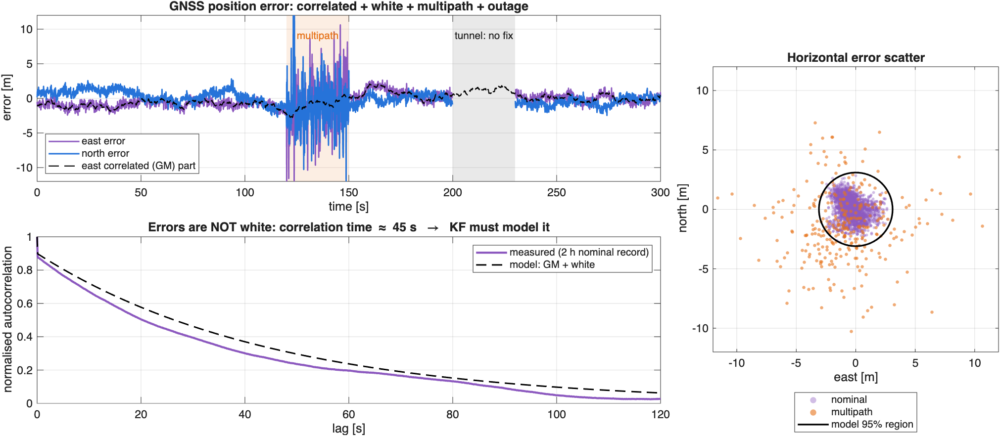
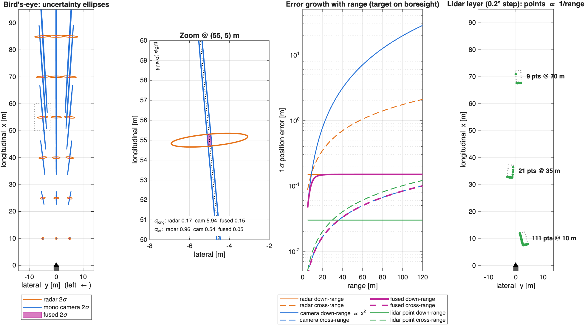

# Module 01: Sensor Physics & Noise Modelling

> A fusion filter is only as good as the covariances you feed it.

This module builds the noise models every later module relies on. Each one is checked against Monte-Carlo runs, theory, or a MathWorks reference implementation.



## A. IMU: gyro noise identification (Allan deviation)

A static gyro record is the sum of independent noise processes (IEEE Std 952). Each one has its own Allan-deviation slope:

| Term | PSD (two-sided) | σ(τ) | Slope |
|---|---|---|---|
| Angle random walk *N* | N² | N/√τ | −½ |
| Bias instability *B* | (B²/2π)/f | 0.664·B | 0 |
| Rate random walk *K* | (K/2π)²/f² | K√(τ/3) | +½ |

**Implementation (`+sf/+imu`)**
- `simulateGyro`: the white term is per-sample std N√fs. True 1/f flicker comes from **FFT spectral shaping**, not a single Gauss-Markov stand-in. RRW is integrated white noise.
- `allanDeviation`: a fully overlapping estimator on the integrated angle. It matches toolbox `allanvar` to 1e-9 (unit test).
- `fitAllan`: Allan variance is linear in [N², B², K²], so the identification is a **non-negative least-squares** fit with no hand-picked slopes. Each point is weighted by its statistical confidence, ∝ √(2(L/m−1)).

**Result** (12 h record @ 100 Hz): N +0.1 %, B +1.8 %, K −1.0 %.
Over a 6-seed Monte-Carlo: N ±0.04 %, B +0.8 ± 1.7 %, K −1.6 ± 4.0 %.

> **Lesson learned:** with a 3 h record, K was off by up to 80 %. The RRW region has too few independent clusters, so real IMU characterization needs records of 12 h or more.
>
> **Convention gotcha:** `imuSensor`'s `NoiseDensity` uses a *one-sided* PSD, so its Allan curve sits √2 below the IEEE (two-sided) definition. Plug a datasheet ARW straight into the wrong convention and your filter's Q is off by 2×.



Right panel: integrating a *stationary* gyro gives about ±7° (3σ) of heading error after 10 min. ARW alone explains less than 0.5°; bias instability and RRW dominate. This is why dead-reckoning must be aided by GNSS (Module 4).

## B. GNSS: errors are not white

`sf.gnss.simulateError` combines:
- receiver white noise (σ = 0.4 m)
- a **Gauss-Markov** correlated error (σ = 1.2 m, τ = 45 s) for atmosphere, orbit, and clock. It uses the exact discretization a = e^(−Δt/τ).
- **multipath** bursts, modelled as heavy-tailed Laplacian errors that break Gaussian assumptions
- **outages** (tunnel)



A Kalman filter that treats this as white noise becomes over-confident. Module 4 handles it with state augmentation and innovation gating.

## C. Measurement geometry: why radar + camera

| Sensor | Down-range σ | Cross-range σ | Origin |
|---|---|---|---|
| Radar (77 GHz) | ~0.15 m, constant | r·σ_az, **linear** in r | chirp bandwidth vs aperture |
| Mono camera | x²/(f·h)·σ_v, **quadratic** in r | x/f·σ_u, tiny | flat-road ranging, pitch error |
| Lidar point | ~3 cm | r·Δaz/√12 | ToF vs angular quantization |

The camera's down-range Jacobian ∂x/∂v = −x²/(f·h) is why monocular depth collapses at range. **Pitch uncertainty** (0.15°, about 3 px), not pixel noise, dominates it.

Radar and camera are uncertain in **orthogonal directions**. Information-form fusion (`sf.filters.infoFuse`) intersects the two ellipses. At (55 m, 5 m), radar's 0.96 m lateral σ and the camera's 5.9 m longitudinal σ fuse to **0.15 m × 0.05 m**.



Right panel: a single lidar layer (0.2° step) puts 111 points on a car at 10 m but only 9 at 70 m. Point-target assumptions break down up close and shape estimation breaks down far away (Module 7).

## D. Teaser: cut-in, single-snapshot fusion

A vehicle cuts in from 70 m. Snapshot-fused mean error is **0.14 m**, against 0.65 m for radar and 4.1 m for the camera. There is no temporal filtering yet; Module 3 adds it.

## Run

```matlab
startup
run('modules/01_sensor_models/main.m')   % ~60 s, writes media/m01_*
runtests('tests/TestModule01SensorModels.m')
```

## Tests (`tests/TestModule01SensorModels.m`)
- ADEV on white noise recovers N, matches toolbox `allanvar` to 1e-9, and the NNLS fit recovers N/B/K
- GNSS Gauss-Markov has the right variance and an e⁻¹ autocorrelation at lag τ
- radar polar→Cartesian covariance matches a 200k-sample Monte-Carlo within 3 %
- camera projection/back-projection round trip; analytic Jacobian = finite differences
- information fusion agrees with the closed form; lidar ray-cast hits only the near face
- `chi2inv` (via `gammaincinv`) matches reference values
