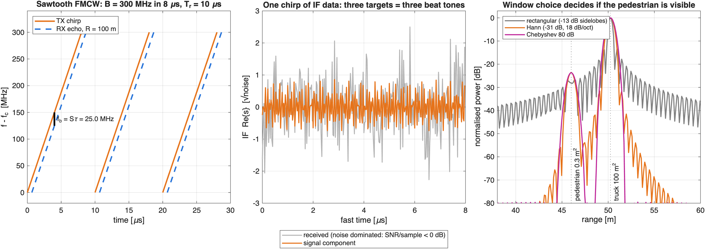
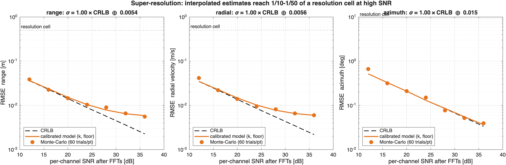
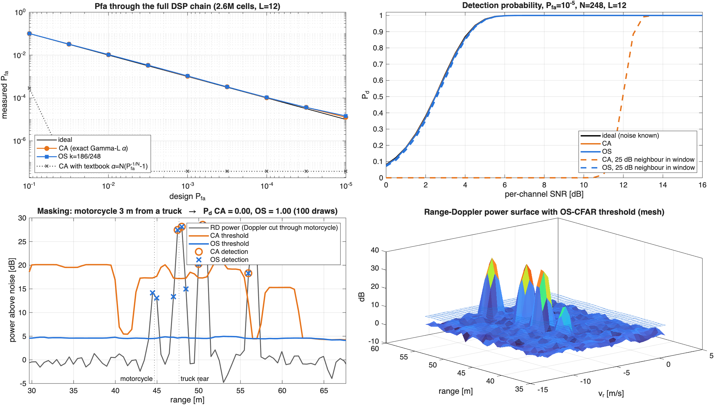

# Module 02: FMCW Radar Signal Processing

> From raw IF samples to calibrated point detections. This is the chain an automotive radar DSP runs every frame.


```
IF cube ─range FFT─▶ ─Doppler FFT─▶ RD map ─CFAR─▶ cells ─peak group + interp─▶
   ─TDM phase comp + angle FFT─▶ detections {R, v_r, az, SNR, Σ} ─RANSAC─▶ ego speed, static/moving
```

Everything in the chain is implemented from scratch in `+sf/+radar`. `drivingScenario` supplies the ground truth only.

## Radar design (`sf.radar.FmcwConfig`)

| Parameter | Value | Governing equation |
|---|---|---|
| Carrier / bandwidth | 77 GHz / 300 MHz | ΔR = c/2B = **0.50 m** |
| Ramp / IQ ADC | 8 µs / 32 MHz × 256 | R_max = f_s·c/2S = **128 m** |
| Chirps | 128 per TX, T_r = 10 µs | Δv = λ/(2·N_d·N_tx·T_r) = **0.51 m/s** |
| MIMO | 3 TX × 4 RX TDM → 12 virtual, λ/2 ULA | v_max = λ/(4·N_tx·T_r) = **±32 m/s**; Δθ ≈ 2/N_v = 9.5° |
| Link budget | 12 dBm, 14+14 dBi, NF 12 dB | 10 m² car at 100 m: −28 dB/sample → **+28 dB** after the 55.9 dB processing gain |

TDM-MIMO costs a factor N_tx in unambiguous velocity, which is why T_r is only 10 µs. A stationary object seen at highway speed (−25 m/s) must fall inside ±v_max.

## A. Fundamentals and the window trade-off



The IF signal is a sum of tones at f_b = 2SR/c, buried under noise per sample; the FFT's coherent gain recovers it. The right panel is the reason windowing matters. A 0.3 m² pedestrian 4 m in front of a 100 m² truck sits **below the rectangular window's sidelobes** but is clearly resolved with Hann.

**Signal model (`synthesizeCube`)**: s = a·exp{j2π[(2SR/c + f_D)t + f_D(mN_tx + p_k)T_r + y_k·sin(az)/λ + 2R/λ]}. It includes range–Doppler coupling, the TDM slot delay p_k·T_r, and the carrier phase, which makes multi-scatterer returns interfere realistically. Range migration (<0.2 m per frame) is neglected, so the signal is separable and hundreds of scatterers synthesize in milliseconds.

## B. Measurement accuracy vs. the Cramér–Rao bound



For a complex tone in complex white noise, σ_bin = √(3/2) / (π√SNR). A Monte-Carlo run (420 trials over 12–36 dB) fits σ² = (k·CRLB)² + floor²:

| | k | floor | interpretation |
|---|---|---|---|
| range | 1.51 | 5.4 mm | Hann window + 3-point interpolation loss |
| radial velocity | 1.43 | 5.6 mm/s | same |
| azimuth | **1.02** | 0.015° | efficient estimator |

At high SNR, interpolated estimates reach **1/50 to 1/100 of a resolution cell**. Each detection gets σ_R, σ_v, σ_az from *its own* SNR, which the tracker in Module 3 will use as R. A unit test checks that the normalized errors have unit variance.

> **Lesson learned:** my first calibration gave k_az = 0.72, i.e. *better* than the CRLB, which is impossible for an unbiased estimator. That pointed to the bound itself. I had used the real-tone constant (12) instead of the complex-tone one (6). Calibrating against theory is how you catch your own derivation errors.

## C. CFAR



After non-coherent integration over N_v = 12 channels, the noise in each cell is **Gamma(12, 1)**, not exponential. The textbook α = N(P_fa^(−1/N) − 1) assumes L = 1. Used here it puts the threshold so high that **essentially no false alarms occur below a design P_fa of 0.1, at the cost of a large loss in detection sensitivity** (top-left, dotted).

Exact thresholds (`cfarAlpha`):
- **CA:** X/(X+ΣZ) ~ Beta(L, NL), so P_fa = 1 − I_{T/(1+T)}(L, NL), closed form.
- **OS:** P_fa = ∫ Q_L(αy)·f_(k)(y) dy over the k-th order-statistic density, integrated numerically.

**Validation through the full DSP chain** (complex noise → windows → FFTs → CFAR, 2.6 M cells): the measured P_fa tracks the design value from 10⁻¹ to 10⁻⁵. At 10⁻⁵ it reads about 30% high, which is consistent with Hann-induced correlation between neighbouring training cells.

**Masking:** a 0.6 m² motorcycle sits 3 m in front of a 300 m² truck, in the same Doppler column, inside the CA training window. Over 100 noise draws, **CA-CFAR detects it 0/100 times and OS-CFAR 100/100**. The Pd curves (top right) show the same: a 25 dB neighbour costs CA more than 10 dB of sensitivity, while OS loses nothing. In clean noise, OS's CFAR loss relative to CA is negligible at N = 248.

## D. Highway scene

Scene: lead car, truck + motorcycle, a fast car in the left lane, a car **stopped on the shoulder**, and guardrails. Over 23 frames:

| Metric | Value |
|---|---|
| Detections / frame | 83 |
| P_d lead car / truck / motorcycle / stopped car | 1.00 / 1.00 / 1.00 / 1.00 |
| P_d left-lane car (at ~100 m) | 0.96 |
| Noise false alarms / frame | 0.83 (design 0.33) |
| Angle-mislocated detections / frame | 20.8 |
| **Ego speed from radar alone (RANSAC)** | **RMSE 0.04 m/s** |

**Two real-world lessons visible in the GIF:**
1. **Unresolved scatterers.** Far away, the left and right guardrail posts share range *and* Doppler and are under 9.5° apart. A 12-element array cannot resolve them, so the angle FFT returns one peak in the wrong place. That's about 21 mislocated detections per frame. They are real energy, not noise, and they're why radar point clouds look "fuzzy" at range. Super-resolution (MUSIC/ESPRIT) or a larger aperture fixes it.
2. **The stationary-vehicle problem.** The car on the shoulder lies exactly on the static-world cosine curve. By Doppler alone it is indistinguishable from guardrail. This is why radar-only ACC systems have historically filtered out stationary objects, and why camera fusion (Module 6) matters.

**Ego-motion:** every static return satisfies v_r = −(v_x cos az + v_y sin az). RANSAC on (az, v_r) gives ego speed to 4 cm/s with no wheel odometry, and labels each detection static or moving for the tracker.

## Run

```matlab
startup
run('modules/02_fmcw_radar/main.m')      % ~2.5 min, writes media/m02_*
runtests('tests/TestModule02Radar.m')
```

## Tests (`tests/TestModule02Radar.m`)
waveform equations · noiseless off-grid target recovered to 2 cm / 0.02 m/s / 0.1° · TDM compensation removes a multi-degree angle bias · exact CA α reduces to the textbook formula at L = 1 · CA/OS α match Monte-Carlo P_fa · OS resists masking where CA fails · RANSAC recovers ego speed with 20% outliers · **detection covariances are statistically consistent** (normalized-error std ≈ 1)
